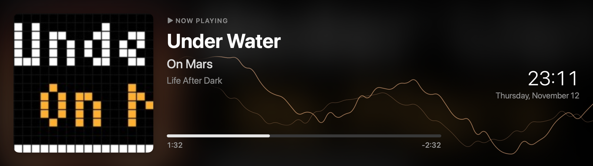

# Edge Now Playing

Shows what Apple Music is playing on a Corsair Xeneon Edge (2560×720), with no iCUE needed: artwork, title, artist, album, progress, a clock, and a line-style spectrum visualizer (left and right channels) tinted by the artwork. A clock fills the screen when nothing is playing. Use the Stream Deck's Multimedia actions for play/pause and skip.



Build and install to `~/Applications`, then start it:

```sh
./build.sh --install
```

- On first run macOS asks to let it control **Music**. Allow it (System Settings → Privacy & Security → Automation). Rebuilding changes the ad-hoc signature, so macOS may ask again.
- macOS also asks to let it record **Music's audio** for the visualizer (System Settings → Privacy & Security → Screen & System Audio Recording). It only measures loudness per frequency band; nothing is recorded or saved. Needs macOS 14.2+.
- Menu bar icon (TV with a note): **Start at Login**, **Quit**.
- The app never opens Music; it only reads it while Music is running.
- It finds the Edge by name, or any screen at least three times wider than tall, and follows display changes.

Render the layout with sample data, without the Edge:

```sh
"$(swift build -c release --show-bin-path)/EdgeNowPlaying" --render out.png [artwork.jpg]
```

## Why no touch

macOS treats the Edge's touch panel (WCH, VID 10176 / PID 2137) as an absolute mouse mapped to the main display. An app can read the touches and block their clicks, but can't stop the pointer jumping to the main display, and the panel ignores the HID touch-mode switch. So input goes through the Stream Deck instead.
