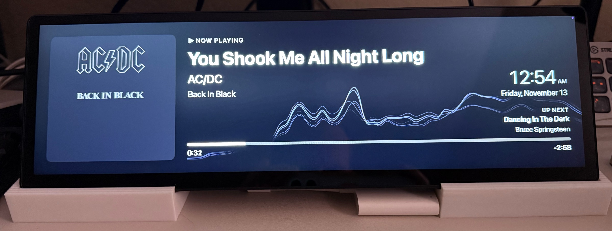
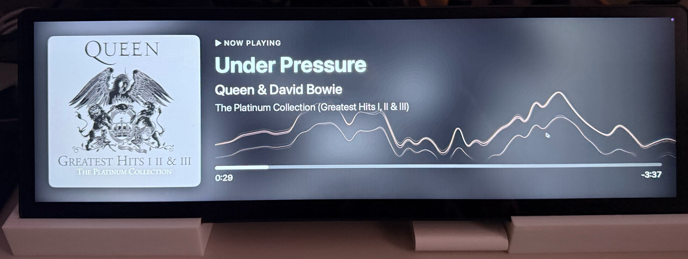

# Edge Now Playing

Shows what Apple Music or Spotify is playing on a **Corsair Xeneon Edge** touchscreen bar connected to a Mac. No iCUE needed.



- Album artwork, title, artist and album, with a progress bar and the time left
- A spectrum visualizer behind the text: one line for the left channel, one for the right, tinted to match the artwork
- A 12-hour clock and date, which fill the screen when nothing is playing and dim to 30% brightness after 15 seconds (you can hide them while music plays)
- The next song, when Music is playing a playlist in order
- Fills the Edge on its own and leaves your main display alone

Corsair's widgets for the Edge need iCUE, which doesn't work on macOS. To macOS the Edge is just a second display, so this app draws straight onto it.

This is an independent project, not affiliated with or endorsed by Corsair, Elgato or Apple.

## Requirements

- macOS 14.2 or later, on Apple Silicon or Intel
- A Xeneon Edge (or any display at least three times wider than tall) connected as a second display
- Apple Music or Spotify

## Install

1. Download `EdgeNowPlaying-<version>.zip` from [Releases](../../releases) and unzip it.
2. Drag **Edge Now Playing** into your **Applications** folder.
3. Open it. The app isn't notarized by Apple, so macOS blocks it the first time:
   - **macOS 15 or later:** open **System Settings → Privacy & Security**, scroll down to the message about Edge Now Playing, and click **Open Anyway**.
   - **macOS 14:** right-click the app and choose **Open**, then **Open** again.
4. Play something in Music or Spotify. macOS asks two questions; allow both (once per player):
   - **Control "Music"** (or "Spotify"): to read the song and the artwork.
   - **Record audio from Music** (or Spotify): for the visualizer. It only measures how loud each frequency band is; nothing is recorded or saved.

Changed your mind? Both are under **System Settings → Privacy & Security** (Automation, and Screen & System Audio Recording).

**About the purple dot:** while music plays, macOS shows a purple dot in the menu bar (and Edge Now Playing under Control Center's recording list). That's macOS flagging the audio tap the visualizer uses, the same indicator any app gets when it listens to system audio. It goes away when the music stops or the app quits. Nothing leaves the app: the sound is turned into the 56 bar heights and thrown away.

## Using it

- **Quit:** right-click its Dock icon and choose Quit, or press ⌘Q while it's in front.
- **Settings:** click the Dock icon (or open the app again) for **Start at Login** and **Show in Dock**. There's also a menu bar icon with the same options.
- **Right-click the Edge** (with the mouse) for Play/Pause, Next Track, Previous Track, Show Clock, Show Up Next, Settings and Quit.
- **Show Clock / Show Up Next:** turn the clock and date, or the next song, on or off. Also in Settings and the menu bar menu. The idle screen always shows the clock.


- **Up Next** only appears when Music plays a playlist from your library with shuffle off. Music doesn't let other apps see its Up Next queue, so streams, stations and shuffled play can't show it, and neither can Spotify (its queue is only in its Web API).
- **Play, pause, skip** also work with your keyboard's media keys or a Stream Deck's Multimedia actions. The Edge's touchscreen isn't used (see below).
- **Music and Spotify:** the app shows whichever is playing; when both are paused, it keeps showing the last one.
- The app never opens Music or Spotify itself; it only reads them while they're running.

## Why the touchscreen isn't used

macOS treats the Edge's touch panel as an absolute mouse mapped to the **main** display, so a tap on the Edge moves the pointer and clicks on your main screen instead. An app can read the touches and block their clicks, but it can't stop the pointer from jumping. The panel also ignores the standard HID switch to touch mode. Paid touchscreen drivers can remap it; this app stays display-only.

Details, for anyone who wants to dig further: the controller reports as `TouchScreen`, vendor ID 10176 (0x27C0), product ID 2137, with a vendor interface (usage page 0xFF0A), an absolute mouse (X 0–16383, Y 0–9599) and a 15-contact digitizer. macOS drives the pointer from the mouse interface through its DriverKit HID driver; seizing the device doesn't stop that.

## Build from source

Needs Xcode or the Command Line Tools.

```sh
./make-cert.sh        # once per Mac: a local signing certificate, so rebuilds keep the permissions
./build.sh --install  # builds a universal app, installs it to /Applications and opens it
```

Without the certificate the build is ad-hoc signed, and macOS asks for the permissions again after every rebuild.

`./release.sh` builds and zips the app for a release. To check the layout without an Edge attached:

```sh
"$(swift build -c release --arch arm64 --arch x86_64 --show-bin-path)/EdgeNowPlaying" --render out.png [artwork.jpg]
```

## How it works

- **Song info:** AppleScript to Music and Spotify, every 2 seconds and whenever either announces a track change. Artwork comes from Music, from Spotify's cover URL, or, for streamed Music songs without artwork, from Apple's iTunes Search.
- **Visualizer:** a Core Audio process tap on the player (macOS 14.2+), a 2048-point FFT with Accelerate, and 56 bands from 35 Hz to 16 kHz with automatic gain.
- **Display:** a borderless window on the Edge, found by name, that follows display changes.

## License

[MIT](LICENSE)
